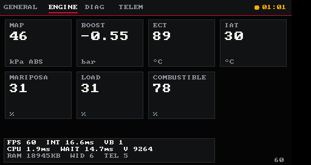
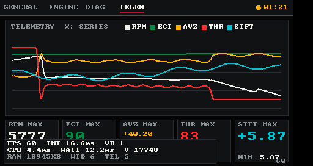
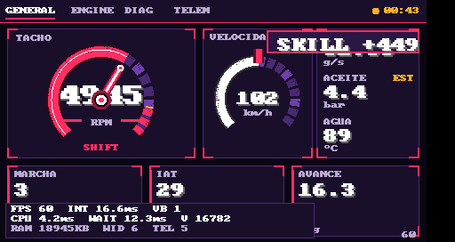

# PSP Torque

**A read-only OBD-II dashboard for the Sony PSP.**

It reads real data from the car through an **ELM327 WiFi** adapter and draws it
on a 480×272 dashboard: tachometer, speedometer, temperatures, airflow,
calculated oil pressure, telemetry traces and fault codes.

Validated on a **Mazda MX-5 NB2 1.8** (K-line) and on an **Alfa Romeo MiTo
Quadrifoglio Verde 2010** (CAN). The core is universal: it speaks only standard
OBD-II (SAE J1979) and adapts to whatever the ECU answers.


*GENERAL on the MX-5: tachometer, speedometer and the air, oil and water block
instead of the MAP that car does not have. Demo data (`SIM`).*

## Compatibility

| Car | State |
|---|---|
| **Mazda MX-5 NB2 1.8** (ISO 9141-2, K-line) | Validated daily. Its own profile: 8,000 tachometer, red zone at 7,000, cut at 7,200 and gear ratios measured on the car. |
| Alfa Romeo MiTo Quadrifoglio Verde 2010 (CAN) | Validated. The car the project started on. |
| Any car with read-only OBD-II | Should work: the app reads which PIDs exist and shows `N/D` for the rest. |

Adapter: ELM327 **WiFi** (tested with a v1.5 clone). The stock PSP does not
support WPA2, so the adapter has to open an open, WEP or WPA-PSK/TKIP network;
with CFW and the `wpa2psp` plugin WPA2 works too. See
[`docs/COMPATIBILIDAD.md`](docs/COMPATIBILIDAD.md).

## What it does

- **Read-only, always.** No clearing codes, no coding, no actuator commands.
  Services 01/02/03/06/07/09/0A only.
- **Nine screens:** four for driving (GENERAL, MOTOR, DIAG, TELEM) and five
  tools (FALLOS, MODULOS, SNIFFER, INFO, SONDA).
- **Ten themes**, and the game ones change the structure of the dial, the needle
  and the indicators, not just the colours.
- **Per-car profile:** scale, red zone, cut and gear indicator come from the
  car's profile, not from a global setting.
- **Nothing invented:** no data is `N/D`; what is calculated (oil pressure,
  boost, gear) is marked `EST` or derived from real measurements.
- **Smooth needles with no prediction:** the tachometer and speedometer approach
  the last measurement and stay there (`AGUJA`).
- **MX-5 demo** with `L`+`R`: 90 s of simulated driving to try the app without a
  car, marked `SIM`.
- **Session log** with three levels (`NO`, `SESION`, `COMPLETO`) and a final
  summary, with CPU, wait and vertex metrics.

| MOTOR | TELEM |
|---|---|
|  |  |

## Install

1. Copy the app folder to the Memory Stick with `EBOOT.PBP` inside:

   ```
   ms0:/PSP/GAME/PSPTorque/EBOOT.PBP
   ```

   Data (settings and logs) lives separately in `ms0:/PSP/SAVEDATA/PSPTORQUE/`,
   and the app creates that folder itself.

2. Power the ELM327 and turn the **ignition** on (engine off for the first
   connection).
3. On the PSP: **Game → Memory Stick → PSP Torque**.
4. If it does not connect: `TRIANGLE` retries with the saved WiFi profile,
   `SQUARE` opens the PSP WiFi dialog.

The adapter address is read from `ms0:/PSP/SAVEDATA/PSPTORQUE/host.txt`
(`192.168.0.10 35000` when the file does not exist).

## Controls

| Button | Action |
|---|---|
| `L` / `R` / `◀` / `▶` | Change driving screen |
| `SELECT` | Screen picker (screens the car cannot use are greyed with the reason) |
| `START` | Settings menu |
| `START` 1.2 s | Exit (clean: saves settings and writes the session summary) |
| `TRIANGLE` | Reconnect with the saved WiFi profile |
| `SQUARE` | PSP WiFi dialog, then reconnect |
| `L` + `R` 1.5 s | Turn the **demo mode** on / off |
| `X` | Skip the boot animation · confirm |
| `CIRCLE` | Cancel a scan · clear the fault screen · reset the learned boost peak |

## Settings

`START` opens the menu: `TEMA`, `COLOR`, `IDIOMA`, `CONTRASTE`, `ANIMACION`,
`MUESTREO`, `EDITAR VISTA`, `PICO MAX`, `SHIFT RPM`, `RPM MAX`, `UNIDADES`,
`TURBO AUTO`, `BOOST MAX`, `HUECO ELM`, `PANTALLA INICIAL`, `DEBUG`, `LOG`,
`AGUJA`, `REPARTO` and `SALIR`. They live in
`ms0:/PSP/SAVEDATA/PSPTORQUE/settings.txt` and apply immediately.

The ones you actually touch:

- **`EDITAR VISTA`** — which value each GENERAL slot shows and how: gauge, bar,
  text or hidden. The view is saved per car.
- **`AGUJA`** — `DIRECT`, `SOFT` (150 ms) or `VERY SOFT` (400 ms) on the
  tachometer and speedometer. Numbers and bars always show the raw measurement.
- **`REPARTO`** (0 to 4) — how many on-screen values share the fast part of the
  link. Lower means a faster needle.
- **`SHIFT RPM`** — where the shift light comes on.
- **`LOG`** — `NO` opens no file; `SESION` keeps boot, status and the summary;
  `COMPLETO` also keeps every command and reply.

| DIAG | Themes |
|---|---|
|  |  |

## Demo mode

Hold `L`+`R` for 1.5 seconds. The header shows `DEMO` and the dashboard presents
a simulated **MX-5 NB2**: idle, a launch in first, a full pull in second to 6,800
rpm, third, a cruise in fifth and braking, in a 90 s cycle that repeats. Engine
speed comes from road speed and the real gear ratios, MAF from the airflow those
revs ask for, and manifold pressure is naturally aspirated.

It needs neither car nor adapter: it is for trying themes, scales and units, or
for a car show. The same combo turns it off.


## Build

You need the [PSPSDK](https://pspdev.github.io/) (or Docker with
`pspdev/pspdev`):

```sh
make            # leaves EBOOT.PBP in the root
make -C tests   # core tests on the PC
```

The full procedure, with Docker, Windows and the Memory Stick install, is in
[`docs/DESARROLLO.md`](docs/DESARROLLO.md).

## Documentation

| Document | Contents |
|---|---|
| [`docs/DESARROLLO.md`](docs/DESARROLLO.md) | Build, install, debug. |
| [`docs/ARQUITECTURA.md`](docs/ARQUITECTURA.md) | How it works inside: link, scheduler, drawing. |
| [`docs/COMPATIBILIDAD.md`](docs/COMPATIBILIDAD.md) | Adapters, PSP WiFi, protocols. |
| [`docs/COMPATIBILIDAD_MX5_NB2.md`](docs/COMPATIBILIDAD_MX5_NB2.md) | What is known about the MX-5 NB2: PIDs, rates, limits. |
| [`docs/PRUEBAS_PENDIENTES.md`](docs/PRUEBAS_PENDIENTES.md) | What still needs testing in the car. |

## Project rules

1. **Read-only.** Nothing is ever written to the ECU.
2. **No invented readings.** A PID that does not exist shows `N/D`, never `0`.
3. **Simulated data is marked** `SIM`, and calculated values `EST`.
4. **`MAP` and `BOOST` are not the same:** `BOOST` is `MAP` minus barometric
   pressure, and if the reference is not trustworthy it is marked `EST`.

## License and disclaimer

MIT, see [`LICENSE`](LICENSE). The project started as
[autografia](https://github.com/autografia/psp-torque)'s work; this fork adds
MX-5 support, the demo, the three-state log and the link scheduling.

It is not a medical device nor a workshop tool: use it as what it is, an
information panel, and do not stare at it more than you would at the car's own
dash.
