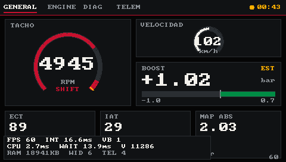
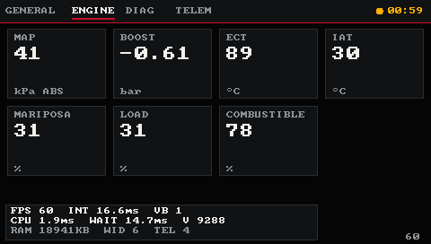
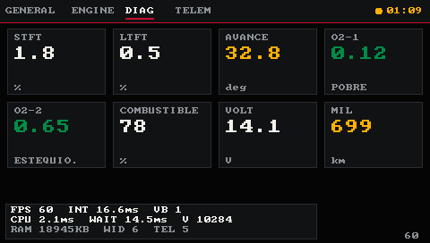
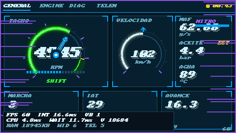

# PSP Torque

**A read-only OBD-II dashboard for the Sony PSP.**

It reads real data from the car through an **ELM327 WiFi** adapter and draws it
on a 480×272 dashboard: tachometer, speedometer, temperatures, airflow,
calculated oil pressure, telemetry traces and fault codes.

Built on a **Mazda MX-5 NB2 1.8** (K-line) and an **Alfa Romeo MiTo
Quadrifoglio Verde 2010** (CAN). The core is universal: standard OBD-II
(SAE J1979) plus read-only UDS identification on CAN, and it adapts to whatever
the ECU answers.


*GENERAL on the MX-5: tachometer, speedometer and the air, oil and water block
instead of the MAP that car does not have. Every number here is simulated
(`DEMO` in the header).*

## Compatibility

| Car | State |
|---|---|
| **Mazda MX-5 NB2 1.8** (ISO 9141-2, K-line) | The car this fork was written on. Validated at idle, during warm-up and on short drives; the driving values, the gear indicator and `FALLOS` are still being tested in the car (see [`docs/PRUEBAS_PENDIENTES.md`](docs/PRUEBAS_PENDIENTES.md)). Its own profile: 8,000 tachometer, red zone at 7,000, cut at 7,200, and gear ratios worked out from the NB2's gearbox and tyre (3.136/1.888/1.330/1.000/0.814, 4.10 final drive, 205/45R16), cross-checked at 3,000 rpm in fifth against the car's own gauge. |
| Alfa Romeo MiTo Quadrifoglio Verde 2010 (CAN) | The car the project started on: idle, warm-up and the CAN link validated, driving values still under test. |
| Any car with read-only OBD-II | Should work: the app reads which PIDs exist and shows `N/D` for the rest. |

The MiTo is the car the project grew up on, and its view is still the
turbo one: the centre of GENERAL is a boost gauge, the tachometer runs to 7,000
with the red zone at 6,500, and the theme effects (the nitrous bar, the
`SKILL` marker, the G-meter) are tuned for it.

| MiTo, GENERAL | MiTo, MOTOR |
|---|---|
|  |  |

*The MiTo view, from a test build with the MiTo profile applied: boost in the
centre and turbo manifold pressure instead of the MAP the MX-5 does not have.
The shipped demo always wears the MX-5 profile.*

Adapter: ELM327 **WiFi**, tested with v1.5 and v2.3 clones. The stock PSP has
no WPA2, so the adapter has to be set to an open, WEP or WPA-PSK/TKIP network;
with CFW and the `wpa2psp` plugin, WPA2 works too. See
[`docs/COMPATIBILIDAD.md`](docs/COMPATIBILIDAD.md) (in Spanish).

## What it does

- **Read-only, always.** Nothing is ever written to the ECU: no clearing
  codes, no coding, no actuator commands. It asks for live data (modes 01 and
  02), stored, pending and permanent codes (03/07/0A) and identification (09),
  and on CAN the MODULES screen adds two read-only UDS queries (tester present
  and ReadDataByIdentifier).
- **Nine screens, eight on a K-line car:** four for driving (GENERAL, MOTOR,
  DIAG, TELEM) and five tools (FALLOS, MODULOS, SNIFFER, INFO, SONDA). SNIFFER
  captures the CAN bus, so a K-line car is offered the other eight.
- **Fourteen themes:** five flat palettes and nine that change the structure of
  the dial, the needle and the indicators, not just the colours.
- **Per-car profile:** scale, red zone, cut and gear indicator come from the
  car's profile, not from a global setting.
- **Nothing invented:** a reading the car does not give shows `N/D`, never
  `0`; what is calculated (oil pressure, boost, gear) is marked `EST` or derived
  from measurements.
- **Smooth needles with no prediction:** the tachometer and speedometer approach
  the last measurement and stay there (`AGUJA`).
- **MX-5 demo** with `L`+`R`: 90 s of simulated driving to try the app without a
  car, marked `DEMO` in the header.
- **Session log** with three levels (`NO`, `SESION`, `COMPLETO`) and a final
  summary; the once-a-second status line carries the CPU, wait and vertex
  metrics.

| MOTOR | TELEM |
|---|---|
|  |  |

*MOTOR and TELEM in demo mode: `DEMO` in the header means every number here is
simulated.*

## Install

**You need** a PSP with custom firmware (tested on a PSP-2000 and a PSP-3000
running ARK4), an ELM327 WiFi adapter, and this app. Take `PSPTorque.zip` from
the [latest release](https://github.com/konqiDAM/psp-torque/releases/latest) and
unzip it under `ms0:/PSP/GAME/`, or build it yourself (see [Build](#build)); a
stock PSP will not run an unsigned EBOOT.

1. Copy the app folder to the Memory Stick with `EBOOT.PBP` inside:

   ```
   ms0:/PSP/GAME/PSPTorque/EBOOT.PBP
   ```

   Data (settings and logs) lives separately in `ms0:/PSP/SAVEDATA/PSPTORQUE/`,
   and the app creates that folder itself.

2. Power the ELM327 and turn the **ignition** on (engine off for the first
   connection).
3. On the PSP: **Game → Memory Stick → PSP Torque**.
4. If it does not connect: `TRIANGLE` retries with the saved WiFi profile,
   `SQUARE` opens the PSP WiFi dialog.

The adapter address is read from `ms0:/PSP/SAVEDATA/PSPTORQUE/host.txt`
(`192.168.0.10 35000` when the file does not exist).

The header says what is wrong before you have to guess: `DESCONECT` (red) means
no link, so press `TRIANGLE`; `ELM ATASCADO` (red) means the adapter stopped
answering and needs a power cycle; `CONECT` that never reaches `ONLINE` means
the PSP joined the network but the adapter did not answer, so check `host.txt`;
`SIN DATOS` and `DATOS VIEJOS` (amber) mean the link is alive and the ECU went
quiet.

## Controls

| Button | Action |
|---|---|
| `L` / `R` / `◀` / `▶` | Change driving screen |
| `SELECT` | Screen picker; screens the car cannot use are left out |
| `START` | Settings menu |
| `START` 1.2 s | Exit (clean: saves settings and writes the session summary) |
| `TRIANGLE` | Reconnect with the saved WiFi profile |
| `SQUARE` | PSP WiFi dialog, then reconnect |
| `L` + `R` 1.5 s | Turn the **demo mode** on / off |
| `X` | Skip the boot animation · confirm |
| `CIRCLE` | Cancel a scan · clear the fault list on screen · in the settings menu, forget the learned boost peak |

## Settings

`START` opens the menu, in this order: `TEMA`, `COLOR`, `CONTRASTE`,
`ANIMACION`, `MUESTREO`, `HUECO ELM`, `EDITAR VISTA`, `PICO MAX`, `SHIFT RPM`,
`RPM MAX`, `UNIDADES`, `TURBO AUTO`, `BOOST MAX`, `IDIOMA`, `FPS`, `PANTALLA
INICIAL`, `DEBUG`, `LOG`, `AGUJA`, `REPARTO` and `SALIR`. They live in
`ms0:/PSP/SAVEDATA/PSPTORQUE/settings.txt` and apply immediately.

*The interface follows the PSP's system language: the names above are the
Spanish ones, and on an English console the same items read THEME, COLOR,
CONTRAST, ANIMATION, SAMPLING, ELM GAP, EDIT VIEW, PEAK HOLD, SHIFT RPM, RPM
MAX, UNITS, TURBO AUTO, BOOST MAX, LANGUAGE, FPS, START SCREEN, DEBUG, LOG,
NEEDLE, SPLIT, EXIT.*

The ones you actually touch:

- **`EDITAR VISTA`** — which value each GENERAL slot shows and how: gauge, bar,
  text or hidden. The view is saved per car.
- **`AGUJA`** — `DIRECTA` / `SUAVE` / `MUY SUAVE` (`DIRECT` / `SOFT` /
  `VERY SOFT`, 150 ms and 400 ms of smoothing) on the tachometer and speedometer.
  Numbers and bars always show the raw measurement.
- **`REPARTO`** (0 to 4) — how many on-screen values share the fast part of the
  link. Lower means a faster needle.
- **`SHIFT RPM`** — where the shift light comes on.
- **`LOG`** — `NO` opens no file; `SESION` keeps boot, status and the summary;
  `COMPLETO` also keeps every command and reply.

| DIAG | FORZA |
|---|---|
|  |  |

*DIAG in demo mode, FORZA theme next to it.*

## Demo mode

Hold `L`+`R` for 1.5 seconds. The header shows `DEMO` (the log says `SIM`) and
the dashboard presents a simulated **MX-5 NB2**: idle, a launch in first, a full
pull in second to the cut, just under 7,000 rpm, third, a cruise in fifth and
braking, in a 90 s cycle that repeats. Engine speed comes from road speed and
the real gear ratios, MAF from the airflow those revs ask for, and manifold
pressure is naturally aspirated.

It needs neither car nor adapter: it is for trying themes, scales and units, or
for a car show. The same combo turns it off.

| NFS | GRAN TURISMO |
|---|---|
|  |  |

*NFS and GRAN TURISMO are the same demo lap as FORZA, two tables up.*

## Build

You need the [PSPSDK](https://pspdev.github.io/) (or Docker with
`pspdev/pspdev`):

```sh
make            # leaves EBOOT.PBP in the root
make -C tests   # core tests on the PC
```

The full procedure, with Docker, Windows and the Memory Stick install, is in
[`docs/DESARROLLO.md`](docs/DESARROLLO.md).

## Documentation

| Document | Contents |
|---|---|
| [`docs/DESARROLLO.md`](docs/DESARROLLO.md) | Build, install, debug. |
| [`docs/ARQUITECTURA.md`](docs/ARQUITECTURA.md) | How it works inside: link, scheduler, drawing (in Spanish). |
| [`docs/COMPATIBILIDAD.md`](docs/COMPATIBILIDAD.md) | Adapters, PSP WiFi, protocols (in Spanish). |
| [`docs/COMPATIBILIDAD_MX5_NB2.md`](docs/COMPATIBILIDAD_MX5_NB2.md) | What is known about the MX-5 NB2: PIDs, rates, limits. |
| [`docs/PRUEBAS_PENDIENTES.md`](docs/PRUEBAS_PENDIENTES.md) | What still needs testing in the car. |

## Project rules

1. **Read-only.** Nothing is ever written to the ECU.
2. **No invented readings.** A PID that does not exist shows `N/D`, never `0`.
3. **Simulated data is marked** `DEMO` on screen and `SIM` in the log, and
   calculated values `EST`.
4. **`MAP` and `BOOST` are not the same:** `BOOST` is `MAP` minus barometric
   pressure, and if the reference is not trustworthy it is marked `EST`.

## License and disclaimer

**GPL-3.0**, see [`LICENSE`](LICENSE) — the licence the project this fork came
from carries. It comes with absolutely no warranty.

The project started as
[autografia](https://github.com/autografia/psp-torque)'s work; this fork adds
MX-5 support, the demo, the three-state log and the link scheduling.

It is not a medical device nor a workshop tool: use it as what it is, an
information panel, and do not stare at it more than you would at the car's own
dash.
