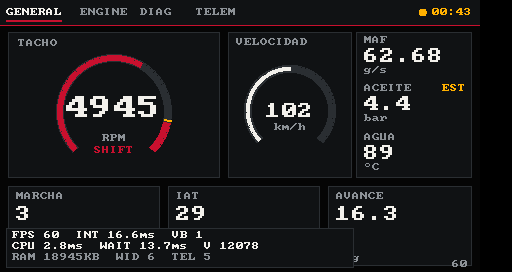
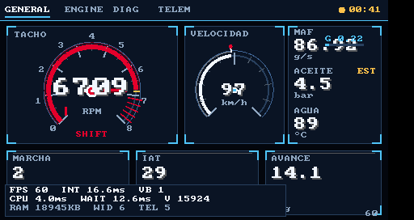

# PSP Torque

**Panel de telemetría OBD‑II de solo lectura para la Sony PSP.**

Lee datos reales del coche por un adaptador **ELM327 WiFi** y los pinta en un
dashboard de 480×272: tacómetro, velocímetro, temperaturas, caudal de aire,
presión de aceite calculada, telemetría con gráficas y códigos de avería.

Validado en un **Mazda MX‑5 NB2 1.8** (K‑line) y en un **Alfa Romeo MiTo
Quadrifoglio Verde 2010** (CAN). El núcleo es universal: usa solo OBD‑II
estándar (SAE J1979) y se adapta a lo que responda cualquier centralita.



*GENERAL en el MX‑5: tacómetro, velocímetro y el bloque de aire, aceite y agua
en lugar del MAP que ese coche no tiene. Datos del modo demo (`SIM`).*

## Compatibilidad

| Coche | Estado |
|---|---|
| **Mazda MX‑5 NB2 1.8** (ISO 9141‑2, K‑line) | Validado en uso diario. Perfil propio: tacómetro a 8000, zona roja en 7000, corte en 7200 y relaciones de cambio medidas en el coche. |
| Alfa Romeo MiTo Quadrifoglio Verde 2010 (CAN) | Validado. Es el coche con el que empezó el proyecto. |
| Cualquier coche con OBD‑II de lectura | Debe funcionar: se lee qué PIDs existen y lo que no, se muestra `N/D`. |

Adaptador: ELM327 **WiFi** (probado con un clon v1.5). La PSP original no
soporta WPA2, así que el adaptador debe abrir una red abierta, WEP o
WPA‑PSK/TKIP; con CFW y el plugin `wpa2psp` vale WPA2. Ver
[`docs/COMPATIBILIDAD.md`](docs/COMPATIBILIDAD.md).

## Qué hace

- **Solo lectura, siempre.** No borra códigos, no codifica y no manda órdenes a
  actuadores. Solo servicios 01/02/03/06/07/09/0A.
- **Nueve pantallas:** cuatro de conducción (GENERAL, MOTOR, DIAG, TELEM) y
  cinco herramientas (FALLOS, MODULOS, SNIFFER, INFO, SONDA).
- **Diez temas**, y los de juego cambian la estructura del reloj, la aguja y los
  indicadores, no solo los colores.
- **Perfil por coche:** fondo de escala, zona roja, corte e indicador de marcha
  salen del perfil del coche, no de un ajuste global.
- **Nada inventado:** sin dato se pinta `N/D`; lo calculado (presión de aceite,
  boost, marcha) va marcado `EST` o se deduce de medidas reales.
- **Agujas suaves sin predicción:** el tacómetro y el velocímetro se acercan a
  la última medida y ahí se quedan (`AGUJA`).
- **Modo demo del MX‑5** con `L`+`R`: 90 s de conducción simulada para probar la
  app sin coche, marcada `SIM`.
- **Log de sesión** con tres niveles (`NO`, `SESION`, `COMPLETO`) y resumen
  final, con métricas de CPU, espera y vértices.

| MOTOR | TELEM |
|---|---|
|  |  |

## Instalación

1. Copia la carpeta de la app a la Memory Stick, con el `EBOOT.PBP` dentro:

   ```
   ms0:/PSP/GAME/PSPTorque/EBOOT.PBP
   ```

   Los datos (ajustes y logs) van aparte, a `ms0:/PSP/SAVEDATA/PSPTORQUE/`, y la
   app crea la carpeta sola.

2. Enciende el ELM327 y pon el **contacto** (motor parado para la primera
   conexión).
3. En la PSP: **Juego → Memory Stick → PSP Torque**.
4. Si no conecta: `TRIANGLE` reintenta con el perfil WiFi guardado, `SQUARE` abre
   el diálogo WiFi de la PSP.

La IP y el puerto del adaptador se leen de
`ms0:/PSP/SAVEDATA/PSPTORQUE/host.txt` (`192.168.0.10 35000` si no existe).

## Controles

| Botón | Acción |
|---|---|
| `L` / `R` / `◀` / `▶` | Cambiar de pantalla de conducción |
| `SELECT` | Selector de pantallas (las que el coche no puede usar salen en gris y con el motivo) |
| `START` | Menú de ajustes |
| `START` 1,2 s | Salir (cierre limpio: guarda ajustes y escribe el resumen del log) |
| `TRIANGLE` | Reconectar con el perfil WiFi guardado |
| `SQUARE` | Diálogo WiFi de la PSP y reconectar |
| `L` + `R` 1,5 s | Activar / desactivar el **modo demo** |
| `X` | Saltar la animación de arranque · confirmar |
| `CIRCLE` | Cancelar un escaneo · limpiar la pantalla de fallos · borrar el pico de boost |

## Ajustes

`START` abre el menú: `TEMA`, `COLOR`, `IDIOMA`, `CONTRASTE`, `ANIMACION`,
`MUESTREO`, `EDITAR VISTA`, `PICO MAX`, `SHIFT RPM`, `RPM MAX`, `UNIDADES`,
`TURBO AUTO`, `BOOST MAX`, `HUECO ELM`, `PANTALLA INICIAL`, `DEBUG`, `LOG`,
`AGUJA`, `REPARTO` y `SALIR`. Se guardan en
`ms0:/PSP/SAVEDATA/PSPTORQUE/settings.txt` y se aplican al instante.

Los que más se tocan:

- **`EDITAR VISTA`** — qué dato pinta cada hueco de GENERAL y cómo: reloj, barra,
  texto u oculto. La vista se guarda por coche.
- **`AGUJA`** — `DIRECTA`, `SUAVE` (150 ms) o `MUY SUAVE` (400 ms) en el
  tacómetro y el velocímetro. Los números y las barras van siempre con la medida.
- **`REPARTO`** (0 a 4) — cuántos valores de la pantalla entran en el cupo rápido
  del enlace. Más bajo, aguja más rápida.
- **`SHIFT RPM`** — a qué régimen se enciende la luz de cambio.
- **`LOG`** — `NO` no abre archivo; `SESION` guarda arranque, estado y resumen;
  `COMPLETO` guarda además cada petición y cada respuesta.

| DIAG | Temas |
|---|---|
|  |  |

## Modo demo

Mantén `L`+`R` durante 1,5 s. La cabecera muestra `DEMO` y el panel presenta un
**MX‑5 NB2** simulado: ralentí, salida en primera, estirada completa en segunda
hasta las 6.800 rpm, tercera, crucero en quinta y frenada, en un ciclo de 90 s
que se repite. El régimen sale de la velocidad y de las relaciones reales del
cambio, el MAF del caudal que pide ese régimen y el MAP es de atmosférico.

No necesita coche ni adaptador: sirve para probar temas, escalas y unidades, o
para una feria. Se desactiva con el mismo combo.



## Compilar

Necesitas el [PSPSDK](https://pspdev.github.io/) (o Docker con `pspdev/pspdev`):

```sh
make            # deja EBOOT.PBP en la raíz
make -C tests   # pruebas del núcleo en el PC
```

El procedimiento completo, con Docker, Windows y la instalación en la Memory
Stick, está en [`docs/DESARROLLO.md`](docs/DESARROLLO.md).

## Documentación

| Documento | Qué hay |
|---|---|
| [`docs/DESARROLLO.md`](docs/DESARROLLO.md) | Compilar, instalar, depurar. |
| [`docs/ARQUITECTURA.md`](docs/ARQUITECTURA.md) | Cómo está montado por dentro: enlace, planificador, pintado. |
| [`docs/COMPATIBILIDAD.md`](docs/COMPATIBILIDAD.md) | Adaptadores, WiFi de la PSP, protocolos. |
| [`docs/COMPATIBILIDAD_MX5_NB2.md`](docs/COMPATIBILIDAD_MX5_NB2.md) | Lo que se sabe del MX‑5 NB2: PIDs, ritmos y límites. |
| [`docs/PRUEBAS_PENDIENTES.md`](docs/PRUEBAS_PENDIENTES.md) | Lo que falta por probar en el coche. |

## Reglas del proyecto

1. **Solo lectura.** Nunca se escribe en la ECU.
2. **No se inventan lecturas.** Un PID que no existe se pinta `N/D`, nunca `0`.
3. **Los datos simulados van marcados** `SIM`, y lo calculado, `EST`.
4. **`MAP` y `BOOST` no son lo mismo:** `BOOST` es `MAP` menos la presión
   barométrica, y si la referencia no es fiable se marca `EST`.

## Licencia y aviso

MIT, ver [`LICENSE`](LICENSE). El proyecto nació del trabajo de
[autografia](https://github.com/autografia/psp-torque); este fork añade el
soporte del MX‑5, la demo, el log de tres estados y el reparto del enlace.

No es un producto sanitario ni una herramienta de taller: úsalo como lo que es,
un panel informativo, y no mires la pantalla más de lo que mirarías el cuadro del
coche. [Versión en inglés](README_EN.md).
